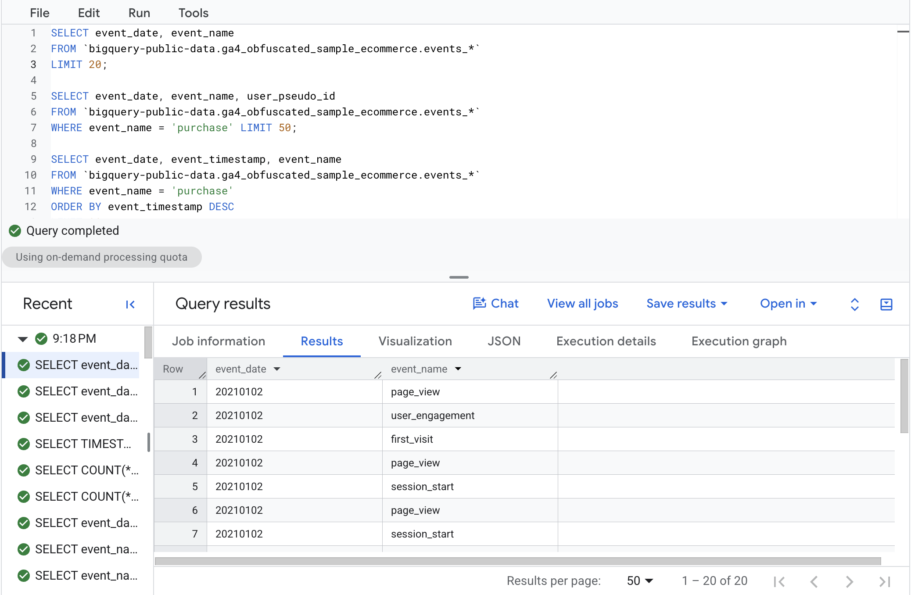
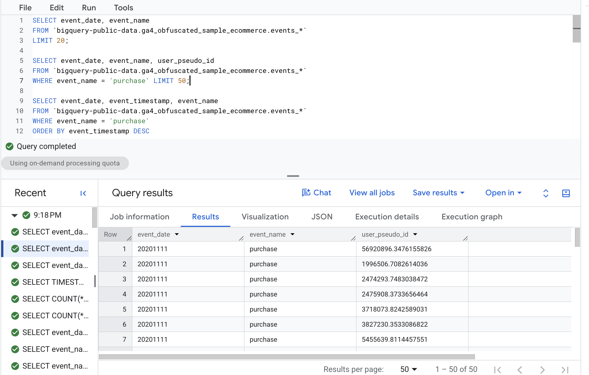
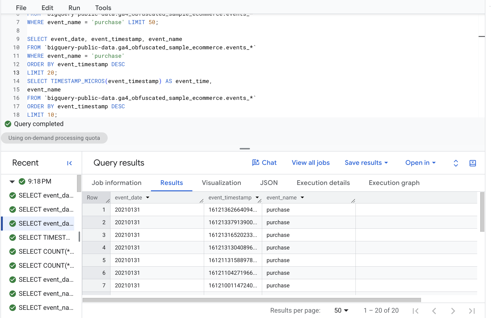
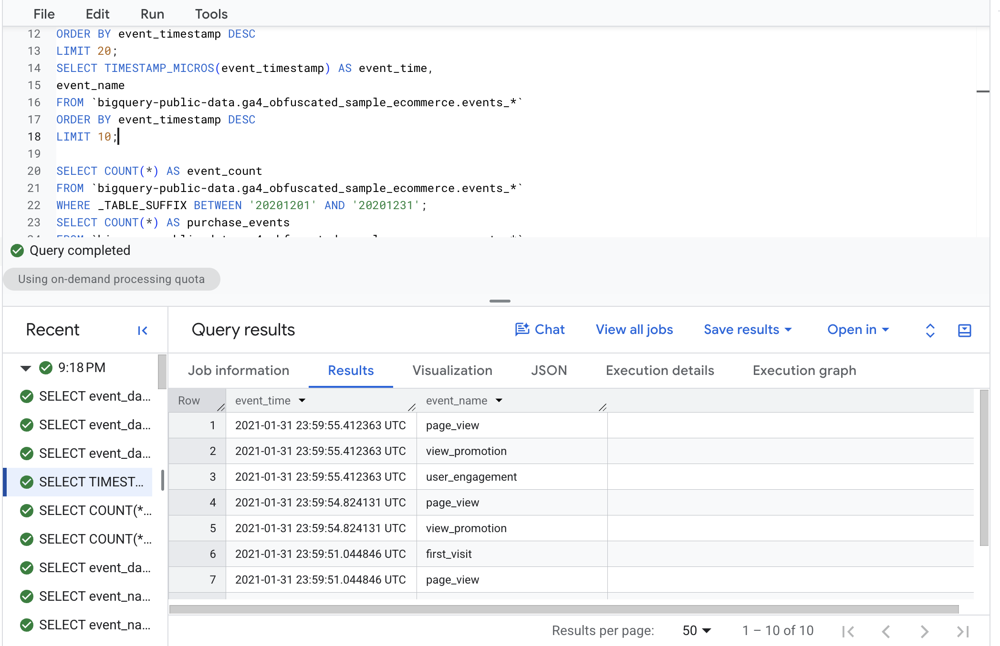
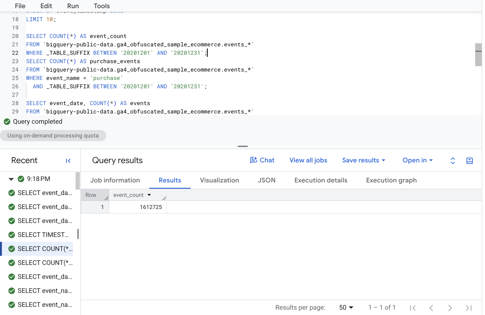
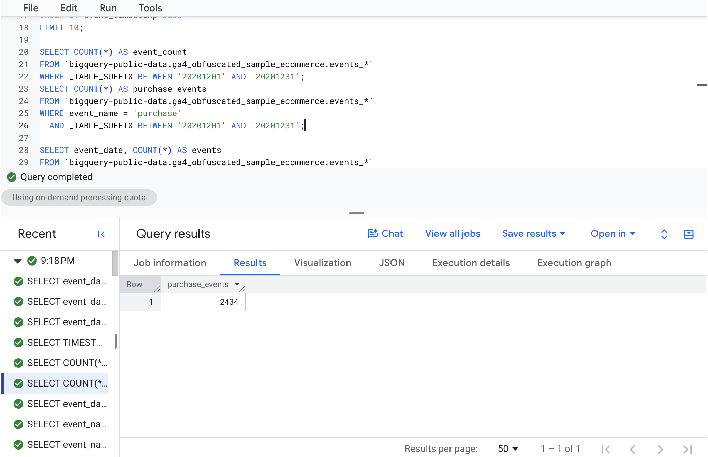
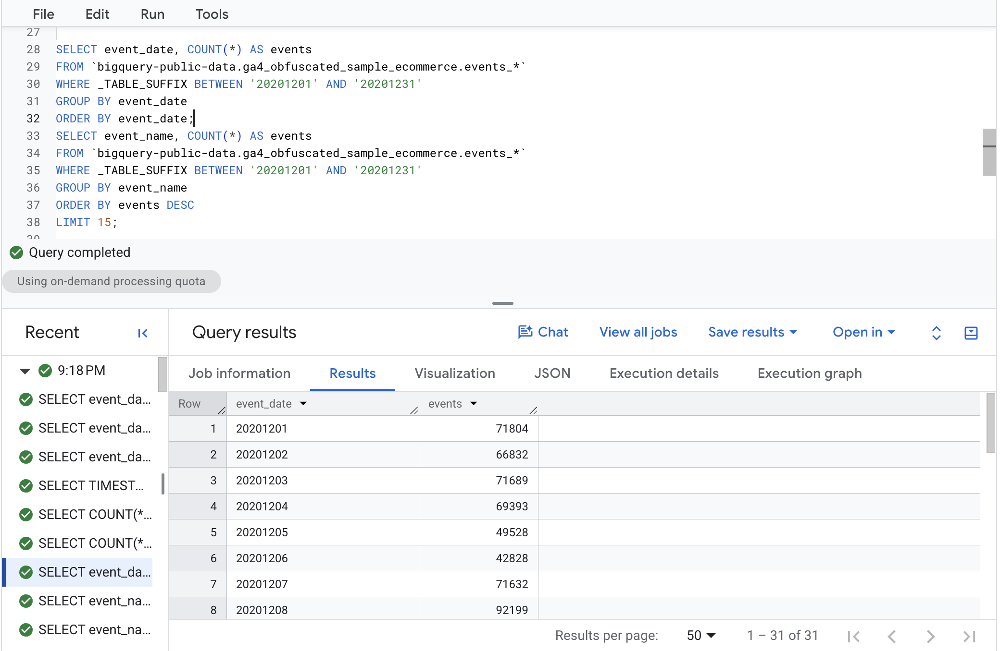
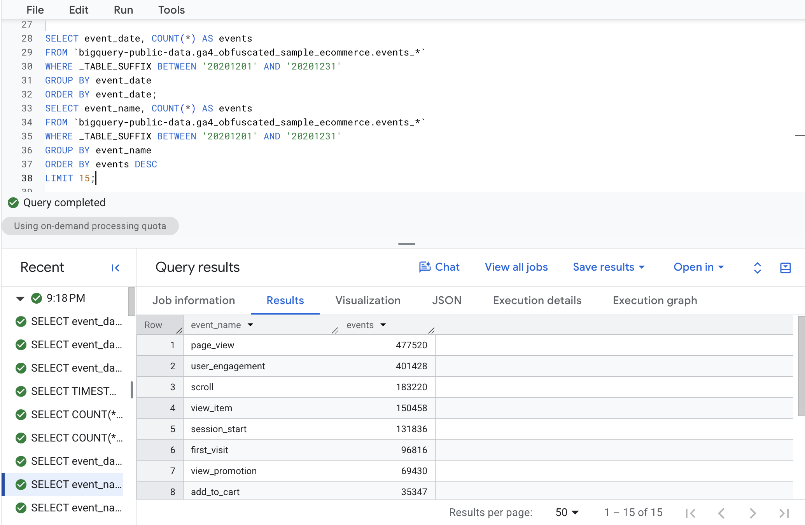
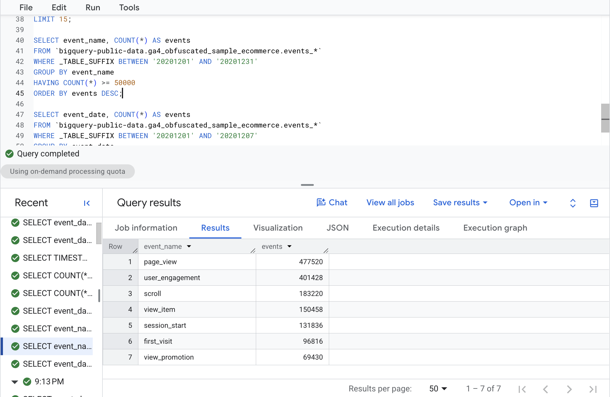
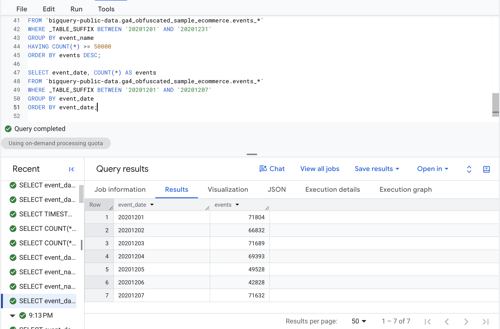

# Introduction

For this assignment, I worked through the SQL examples from Lecture 1 using Google's public GA4 e-commerce dataset in BigQuery. Most of the SQL concepts were familiar from my previous coursework, but this gave me some practice applying them to actual Google Analytics data.

I ran each query in BigQuery and included screenshots of the results below.

# 1. SELECT / FROM / LIMIT

Starting with a basic query, I pulled the event dates and names from the GA4 dataset. `LIMIT 20` keeps the output to just 20 rows instead of pulling everything.

``` sql
SELECT event_date, event_name
FROM `bigquery-public-data.ga4_obfuscated_sample_ecommerce.events_*`
LIMIT 20;
```



# 2. WHERE

Here, I used `WHERE` to filter for purchase events only. I also included `user_pseudo_id` to identify which users were associated with each event, and limited the output to 50 rows.

``` sql
SELECT event_date, event_name, user_pseudo_id
FROM `bigquery-public-data.ga4_obfuscated_sample_ecommerce.events_*`
WHERE event_name = 'purchase'
LIMIT 50;
```



# 3. ORDER BY

This query is similar to the previous one, but I added `ORDER BY` to sort purchases by their timestamps. Using `DESC` puts the most recent purchases first, and `LIMIT 20` keeps the results manageable.

``` sql
SELECT event_date, event_timestamp, event_name
FROM `bigquery-public-data.ga4_obfuscated_sample_ecommerce.events_*`
WHERE event_name = 'purchase'
ORDER BY event_timestamp DESC
LIMIT 20;
```



# 4. TIMESTAMP_MICROS

One thing I noticed is that GA4 timestamps aren't very readable in their original format. `TIMESTAMP_MICROS()` converts them into actual dates and times, which makes the results much easier to interpret.

``` sql
SELECT TIMESTAMP_MICROS(event_timestamp) AS event_time,
       event_name
FROM `bigquery-public-data.ga4_obfuscated_sample_ecommerce.events_*`
ORDER BY event_timestamp DESC
LIMIT 10;
```



# 5. Aggregate Functions

Next, I used `COUNT(*)` to summarize the number of events in the dataset. Instead of returning individual records, these queries give me the total number of events that meet certain conditions.

## 5.1 Total Events

This query counts all events from December 2020. I used `_TABLE_SUFFIX` to specify which daily tables BigQuery should include.

``` sql
SELECT COUNT(*) AS event_count
FROM `bigquery-public-data.ga4_obfuscated_sample_ecommerce.events_*`
WHERE _TABLE_SUFFIX BETWEEN '20201201' AND '20201231';
```



There were **1,612,725 total events** recorded during December 2020.

## 5.2 Purchase Events

I used the same approach here, but added a `WHERE` condition to count purchases specifically.

``` sql
SELECT COUNT(*) AS purchase_events
FROM `bigquery-public-data.ga4_obfuscated_sample_ecommerce.events_*`
WHERE event_name = 'purchase'
  AND _TABLE_SUFFIX BETWEEN '20201201' AND '20201231';
```



Of those events, only **2,434 were purchases**. This shows how much of the website's activity comes from browsing and engagement rather than actual purchases.

# 6. GROUP BY

`GROUP BY` lets me break down the event counts by different categories instead of getting just one total. I used it to look at daily activity and the most common event types.

## 6.1 Events by Day

Here, I grouped the events by date to see how many occurred each day in December. I also sorted the results by date to make them easier to compare.

``` sql
SELECT event_date, COUNT(*) AS events
FROM `bigquery-public-data.ga4_obfuscated_sample_ecommerce.events_*`
WHERE _TABLE_SUFFIX BETWEEN '20201201' AND '20201231'
GROUP BY event_date
ORDER BY event_date;
```



This gives me a better idea of how activity changes throughout the month rather than just looking at the monthly total.

## 6.2 Top Event Types

Instead of grouping by date, I grouped by `event_name` to see which actions users performed most frequently. The results are sorted from highest to lowest.

``` sql
SELECT event_name, COUNT(*) AS events
FROM `bigquery-public-data.ga4_obfuscated_sample_ecommerce.events_*`
WHERE _TABLE_SUFFIX BETWEEN '20201201' AND '20201231'
GROUP BY event_name
ORDER BY events DESC
LIMIT 15;
```



`page_view` was the most common event with **477,520 occurrences**, followed by `user_engagement` with **401,428**. It makes sense that these would be much more frequent than purchases.

# 7. HAVING

`HAVING` is similar to `WHERE`, except it filters the results after they've been grouped. In this case, I only wanted event types that occurred at least 50,000 times.

``` sql
SELECT event_name, COUNT(*) AS events
FROM `bigquery-public-data.ga4_obfuscated_sample_ecommerce.events_*`
WHERE _TABLE_SUFFIX BETWEEN '20201201' AND '20201231'
GROUP BY event_name
HAVING COUNT(*) >= 50000
ORDER BY events DESC;
```



Only seven event types met the requirement. This would be useful if I wanted to focus on the most common customer actions without including every smaller event category.

# 8. Wildcard Tables and \_TABLE_SUFFIX

GA4 stores its exported data in separate daily tables, so `events_*` allows me to query multiple days at once. I can then use `_TABLE_SUFFIX` to narrow down the dates rather than scanning every available table.

``` sql
SELECT event_date, COUNT(*) AS events
FROM `bigquery-public-data.ga4_obfuscated_sample_ecommerce.events_*`
WHERE _TABLE_SUFFIX BETWEEN '20201201' AND '20201207'
GROUP BY event_date
ORDER BY event_date;
```



This time, I only pulled data from December 1–7, giving me seven rows instead of the full month. Besides being more specific, this can also help reduce processing costs by limiting how much data BigQuery scans.

# Reflection

I've used SQL before, so most of the basic functions weren't particularly difficult. The main difference here was working with GA4 event data in BigQuery rather than the more traditional tables I've used in previous courses.

I thought `GROUP BY` was probably the most useful part of the assignment since it lets me turn thousands of individual events into something I can actually analyze. I also found `_TABLE_SUFFIX` interesting because I hadn't worked much with datasets that store records in separate daily tables.

I could definitely see BigQuery being useful for digital marketing analytics, especially when working with large amounts of website traffic and customer behavior data. Being able to query GA4 data directly would give me more flexibility to analyze things like purchases, engagement, and trends over time without being limited to the standard Google Analytics reports.

# Appendix

[GH Repo](https://github.com/itsnik1/bigquery-sql-lecture-1)

[Published Page](https://itsnik1.github.io/bigquery-sql-lecture-1/)
